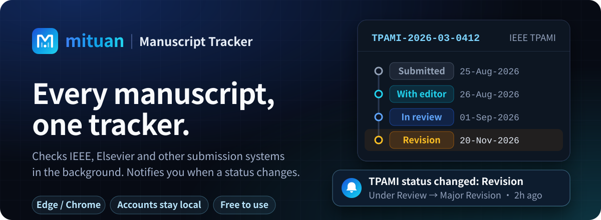
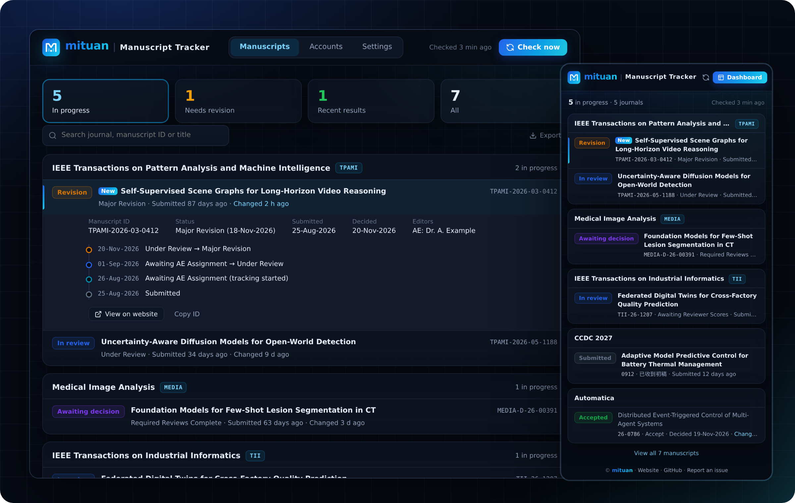

<p align="center">
  
</p>

<p align="center">
  <a href="README.md">简体中文</a> · <b>English</b>
</p>

<p align="center">
  <a href="https://tracker.eonmaze.com/">Website</a> ·
  <a href="https://microsoftedge.microsoft.com/addons/detail/hkljgniplahnifceaoaehfkefbcilmpd">Edge Add-ons</a> ·
  <a href="https://chromewebstore.google.com/detail/cgegoafnapldoacegnnapjbhpfnmjijo">Chrome Web Store</a> ·
  <a href="#install">Install</a> ·
  <a href="#supported-platforms">Supported platforms</a> ·
  <a href="https://github.com/mituan-ai/manuscript-tracker/issues">Report an issue</a>
</p>

<p align="center">
  
  
  <a href="LICENSE"></a>
</p>

<p align="center">
  
  <br><sub>Left: dashboard · Right: toolbar popup. Manuscript IDs, titles and names in the screenshot are fictional.</sub>
</p>

**mituan Manuscript Tracker** is an Edge / Chrome extension. From your own browser, it signs in to your submission systems on a schedule, gathers the status of all your manuscripts in one place, and sends a desktop notification when a status changes. There is no sign-up and no server. Your accounts are stored encrypted on your computer only. The interface is available in English and Simplified Chinese; it follows your system language by default, and you can switch in "Settings".

## Features

- **Automatic sign-in, background checks**: Connect each type of journal once, either by entering your account or by signing in normally on the submission site. After that, sign-in and checks run in the background. You don't need to keep any submission site open.
- **Organized by journal**: Each journal gets its own card showing the stage of every manuscript: submitted, with editor, under review, awaiting decision, revision, accepted or rejected. You don't need to remember which submission system it is in.
- **Notified on change**: You get a desktop notification and a badge on the icon as soon as a status changes. Every manuscript has a status timeline, and you can export all records as Markdown.
- **Add other sites in one click**: On another submission site's manuscript list, click the extension icon. If manuscripts are found, choose "Track these manuscripts".
- **Accounts stay on your computer**: Accounts are stored encrypted and sent only to the sign-in page of the platform they belong to. Access is read-only: the extension never submits, edits or withdraws a manuscript.

## Supported platforms

The extension works per submission system, so every journal on a supported system can use it. The table marks which platforms have been verified with real manuscripts.

| Platform | Example journals / conferences | How it connects |
| --- | --- | --- |
| **IEEE**<br>ScholarOne · IEEE Author Portal<br> | TPAMI, TNNLS, TII, TMI, TPWRS, T-ASE and other IEEE journals | Enter your account once; signs in automatically |
| **Elsevier**<br>Track your submission<br> | Pattern Recognition, Medical Image Analysis, Applied Energy, Water Research, Neural Networks and more | Tracking link from the submission confirmation email; no sign-in needed |
| Springer Nature<br> | Nature Medicine and other Nature journals, Springer journals | Generic recognition: add from the manuscript list page |
| IFAC PaperPlaza<br> | Automatica, IFAC World Congress and other IFAC journals and conferences | Enter your account once; signs in automatically |
| TCCT CMS<br> | CCDC (Chinese Control and Decision Conference), CCC (Chinese Control Conference) | Enter your account once; signs in automatically |
| ScholarOne journals of other publishers<br> | Wiley, Taylor & Francis, The BMJ and more | Added automatically after you open the journal's Author Center once in your browser |
| Other submission systems<br> | Editorial Manager, eJournalPress and other systems that list manuscripts in a table | Generic recognition: add from the manuscript list page |

- &nbsp; Tested with real manuscripts under review.
- &nbsp; Integrated and tested with Elsevier's official sample manuscript, but not yet with a real manuscript under review.
- &nbsp; Generic recognition that is not specific to any journal. It looks for a table with both a "manuscript ID or title" column and a "status" column. If it finds none, it shows nothing and does not guess.

IEEE journals that use PaperCept, such as IEEE TAC and RA-L, are not supported yet. If your journal's system isn't listed or isn't recognized, please tell us which system it is in [Issues](https://github.com/mituan-ai/manuscript-tracker/issues).

## Install

Install from your browser's extension store. Updates are automatic. Both store listings are still under review, so the links below won't open until they go live.

- **Edge**: open [Microsoft Edge Add-ons](https://microsoftedge.microsoft.com/addons/detail/hkljgniplahnifceaoaehfkefbcilmpd), click "Get", then "Add extension".
- **Chrome**: open the [Chrome Web Store](https://chromewebstore.google.com/detail/cgegoafnapldoacegnnapjbhpfnmjijo), click "Add to Chrome", then "Add extension".
- Chromium-based browsers such as Brave and Vivaldi can usually install from the Chrome Web Store too.

When the extension is installed, the browser opens a page that says it was installed successfully. Choose your journal types and connect your accounts there.

If you installed the zip manually before: on the extensions page (`edge://extensions` or `chrome://extensions`), click "Remove" on the old card, install from the store, and connect your accounts again. The manually installed version no longer gets updates.

## Usage

Click the mituan icon on the toolbar, then "Dashboard". Connect each platform you submit to:

| Platform | How to connect |
| --- | --- |
| IEEE, IFAC PaperPlaza, TCCT | On the "Accounts" tab, enter your account and click "Save and verify". Or just sign in normally on the submission site once; the extension remembers an account after a successful sign-in (you can turn this off in "Settings"). |
| Elsevier | Open the "Track your submission" link from the submission confirmation email, click the extension icon on that page, then "Track this manuscript". You can also paste the link on the "Accounts" tab. |
| Other submission sites | Sign in and open the page that lists your manuscripts, such as "Submissions Being Processed" in Editorial Manager. Click the extension icon, choose "Track these manuscripts" if manuscripts are found, then allow the extension to access the site so it can update in the background. |

Everything after that is automatic. By default, IEEE journals are checked every 2 hours and other platforms every 6 hours; you can change this in "Settings". Click the toolbar icon to see active manuscripts grouped by journal. The dashboard lists all manuscripts; open one to see its status timeline.

For sites added through generic recognition, the extension does not store a password. It refreshes using your browser's existing sign-in. When that sign-in expires, the panel tells you, and opening the page once more brings it back. Sites you haven't allowed background access to are updated only when you open that page.

## Accounts and privacy

- **Encrypted storage**: Passwords are encrypted with AES-GCM and kept in the browser's extension storage. The key is generated by the browser, cannot be exported, and stays on your computer.
- **Sent only to their own platform**: The code has a domain allowlist (`CREDENTIAL_ORIGINS` in `lib/http.js`), so each account goes only to the sign-in address of its platform. Scripts on web pages can't read your passwords.
- **Read-only**: The extension opens only the pages needed to read status. It never submits, edits or withdraws a manuscript.
- **No server**: The extension connects only to the submission platforms you use. Access to other sites is requested per site and revoked when you remove the site.
- **No repeated password attempts**: If a platform rejects a password once, the extension stops retrying automatically until you update it, so your account doesn't get locked or hit a CAPTCHA.
- **Clear everything**: "Clear all" in "Settings" deletes all accounts, keys and records. Uninstalling the extension deletes them too.

## FAQ

<details>
<summary><b>Do I need to keep the submission sites open?</b></summary>

No. Sign-in and checks run in the background. Even after you close all browser windows, the extension keeps checking on schedule as long as the browser is still running in the background. In Edge, "Settings → System and performance → Continue running background extensions and apps when Microsoft Edge is closed" is on by default. In Chrome, the setting is "Settings → System → Continue running background apps when Google Chrome is closed". No checks run while the browser is fully quit or the computer is off; missed checks run as soon as you open the browser again.

</details>

<details>
<summary><b>Why does ScholarOne keep signing me out?</b></summary>

All IEEE journal sites share one session, so opening any site's home page from a bookmark or the address bar signs you out of all of them. The extension first opens the sign-in pages of every site it needs, then submits the accounts one by one, so all sites stay signed in at once. If you have used ScholarOne in the last 10 minutes, or you are on a ScholarOne page right now, the extension skips that round so it doesn't interrupt you.

</details>

<details>
<summary><b>Why did a small window pop up?</b></summary>

Some sign-ins only work in a real page, for example behind the firewall on the IEEE account page, or when ScholarOne occasionally shows a Cloudflare check. In those cases the extension fills in the form in a minimized window and closes it when done, usually within seconds. If a CAPTCHA or human verification appears, the window stays open and you get a notification asking you to handle it.

</details>

<details>
<summary><b>Will I get too many notifications?</b></summary>

The first check only records manuscripts and sends no notifications. After that, newly found manuscripts trigger a notification only if they were submitted within the last 30 days. A manuscript that appears in both ScholarOne and IEEE Author Portal notifies you only once. If you resubmit under the same title after a decision such as Reject and Resubmit, the old manuscript is automatically counted as revised.

</details>

<details>
<summary><b>Is there a Tampermonkey userscript version?</b></summary>

No. A userscript runs only while you have the matching page open, so it can't check in the background after you close the page, sign in automatically or send desktop notifications. Those are the most useful parts of this tool. Installing the extension is as easy as installing a userscript.

</details>

<details>
<summary><b>How do I report a problem?</b></summary>

In the dashboard, open "Settings" and click "Copy diagnostics", then paste it into an [issue](https://github.com/mituan-ai/manuscript-tracker/issues). Diagnostics include only the version, platform status and run logs. They contain no accounts, passwords or manuscript titles.

</details>

## Development

Plain JavaScript (Manifest V3) with no build step. After making changes, click "Reload" on the extensions page.

```text
background.js        scheduling, notifications, message handling
adapters/            one file per platform: rex, scholarone, paperplaza, tcct, elsevier, web (generic recognition)
content/login.js     fills in forms in sign-in windows; remembers sign-ins in your tabs
content/capture.js   recognizes manuscripts when you open a site you've added
lib/scan.js          generic recognition: finds manuscript tables on any page
lib/vault.js         encrypted account storage
lib/http.js          requests, domain allowlist, block detection
lib/extract.js       page parsing (runs with DOMParser in an offscreen document)
lib/worker.js        minimized sign-in windows
lib/store.js         manuscript merging, status history, settings
lib/normalize.js     status classification, dates
lib/view.js          manuscript view for the UI: grouping by journal, filters, problem hints
ui/                  popup and dashboard
site/                website (product overview and install guide)
deploy/              website nginx config and deployment steps
```

```bash
npm install          # installs linkedom, used only by the tests
npm test             # parsers, generic recognition, status classification, merging, RSA encryption
npm run deploy       # for development: copies to a Windows folder (under WSL); then click "Reload"
npm run package      # packs dist/manuscript-tracker-<version>.zip for the extension stores (without the manifest key)
npm run build:site   # builds the website into dist/site/
npm run deploy:site  # publishes the website to the server; see deploy/README.md for first-time setup
```

Parser tests that use real pages read them from `test/fixtures.local/`. Those pages contain personal submission data and are listed in `.gitignore`; without them, the related tests are skipped. In the extension's service worker console, `tracker.runPlatform('scholarone', { force: true })` runs one platform manually. Run logs are at the bottom of the "Settings" tab.

## License

This project is licensed under [PolyForm Noncommercial 1.0.0](LICENSE). Personal study and research, and noncommercial use by universities, research institutions, charities and similar organizations, may use, modify and distribute it for free; distributions must keep the license and copyright notice. Commercial use of any kind is not permitted.

<p align="center"><sub>Made by <a href="https://mituan-ai.github.io/">mituan</a> · <a href="https://tracker.eonmaze.com/">tracker.eonmaze.com</a></sub></p>
