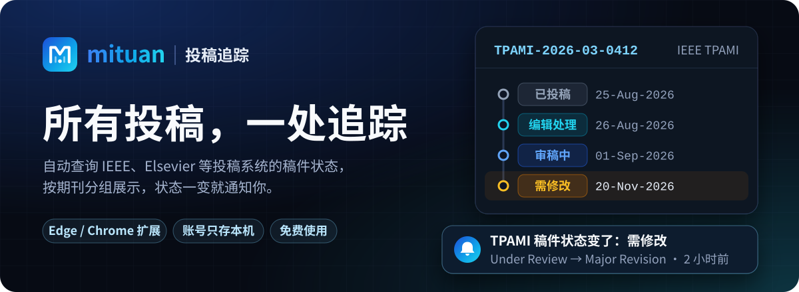
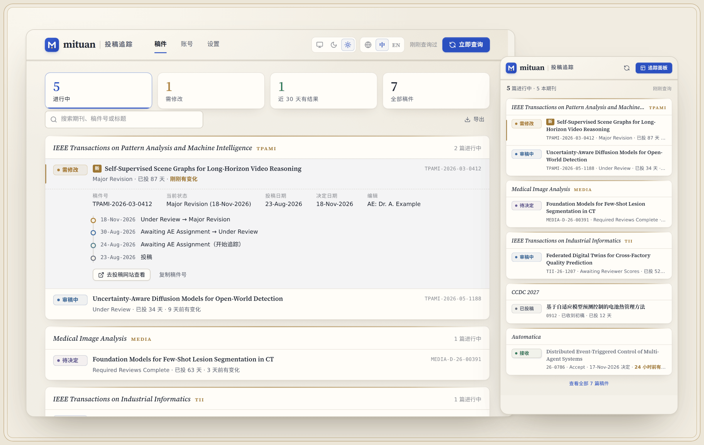

<p align="center">
  
</p>

<p align="center">
  <b>简体中文</b> · <a href="README.en.md">English</a>
</p>

<p align="center">
  <a href="https://tracker.eonmaze.com/">官网</a> ·
  <a href="https://microsoftedge.microsoft.com/addons/detail/hkljgniplahnifceaoaehfkefbcilmpd">Edge 加载项</a> ·
  <a href="https://chromewebstore.google.com/detail/cgegoafnapldoacegnnapjbhpfnmjijo">Chrome 应用商店</a> ·
  <a href="#安装">安装</a> ·
  <a href="#支持范围">支持范围</a> ·
  <a href="https://github.com/mituan-ai/manuscript-tracker/issues">反馈问题</a>
</p>

<p align="center">
  
  
  <a href="LICENSE"></a>
</p>

<p align="center">
  
  <br><sub>左：追踪面板 · 右：工具栏弹窗。截图里的稿件号、标题和人名均为虚构。</sub>
</p>

**mituan 投稿追踪**是一个 Edge / Chrome 扩展。它在你自己的浏览器里定时登录各投稿系统，把所有稿件的状态汇总到一处，状态有变化时发桌面通知。不需要注册，也没有服务器，账号只加密保存在本机。界面有简体中文和英文两种，默认跟随系统语言，可在「设置」里切换。

## 核心功能

- **自动登录，后台查询**：每类期刊只需连接一次账号，填写或在投稿网站上正常登录一次都可以。之后的登录和查询都在后台完成，不用开着任何投稿网页。
- **按期刊组织**：每本期刊一张卡片，标出每篇稿件所处的阶段：已投稿、编辑处理、审稿中、待决定、需修改、接收或拒稿。你不用关心它在哪个投稿系统里。
- **变化即通知**：状态一变就发桌面通知，图标上显示角标。每篇稿件都有状态时间线，全部记录可以导出成 Markdown。
- **一键添加其他网站**：在其他投稿网站的稿件列表页点扩展图标，识别到稿件时会出现「追踪这些稿件」。
- **账号只在本机**：账号加密存储，只发往所属平台的登录地址；只读访问，不会提交、修改或撤回任何稿件。

## 支持范围

扩展按投稿系统接入，同一系统上的期刊都能用。下表分开标明哪些已经用真实稿件验证过。

| 平台 | 代表期刊 / 会议 | 接入方式 |
| --- | --- | --- |
| **IEEE**<br>ScholarOne · IEEE Author Portal<br> | TPAMI、TNNLS、TII、TMI、TPWRS、T-ASE 等 IEEE 期刊 | 填一次账号，自动登录 |
| **Elsevier**<br>Track your submission<br> | Pattern Recognition、Medical Image Analysis、Applied Energy、Water Research、Neural Networks 等 | 投稿确认邮件里的追踪链接，无需登录 |
| Springer Nature<br> | Nature Medicine 等 Nature 系列期刊、Springer 期刊 | 通用识别：在稿件列表页添加 |
| IFAC PaperPlaza<br> | Automatica、IFAC 世界大会等 IFAC 期刊和会议 | 填一次账号，自动登录 |
| TCCT CMS<br> | CCDC 中国控制与决策会议、CCC 中国控制会议 | 填一次账号，自动登录 |
| 其他出版社的 ScholarOne 期刊<br> | Wiley、Taylor & Francis、The BMJ 等 | 在浏览器里打开一次该期刊的作者中心后自动加入 |
| 其他投稿系统<br> | Editorial Manager、eJournalPress 等用表格列出稿件的系统 | 通用识别：在稿件列表页添加 |

- &nbsp; 用真实在审稿件验证过。
- &nbsp; 已接入，并用 Elsevier 官方示例稿件测试通过，还没有用真实在审稿件验证。
- &nbsp; 通用识别，不针对具体期刊。它在页面上找同时有「稿件号或标题」和「状态」两列的表格，识别不到时不显示，不会猜。

IEEE TAC、RA-L 等通过 PaperCept 投稿的 IEEE 期刊暂不包括。你的期刊用的系统不在表里，或者识别不出来，欢迎在 [Issues](https://github.com/mituan-ai/manuscript-tracker/issues) 告诉我们是哪个系统。

## 安装

从浏览器的扩展商店安装，之后会自动更新。两个商店都在审核中，上线前下面的链接还打不开。

- **Edge**：打开 [Microsoft Edge 加载项](https://microsoftedge.microsoft.com/addons/detail/hkljgniplahnifceaoaehfkefbcilmpd)，点「获取」→「添加扩展」。
- **Chrome**：打开 [Chrome 应用商店](https://chromewebstore.google.com/detail/cgegoafnapldoacegnnapjbhpfnmjijo)，点「添加至 Chrome」→「添加扩展程序」。
- Brave、Vivaldi 等 Chromium 内核浏览器一般也能从 Chrome 应用商店安装。

装好后浏览器会自动打开写着「安装成功」的页面，在那里选择期刊类型、连接账号。

以前用 zip 手动安装过的：先在扩展页（`edge://extensions` 或 `chrome://extensions`）点旧版卡片上的「移除」，再从商店安装，然后重新连接一次账号。手动安装的版本以后不再更新。

## 使用

点工具栏上的 mituan 图标，再点「追踪面板」。按你投稿的平台选一种方式连接：

| 平台 | 怎么连接 |
| --- | --- |
| IEEE、IFAC PaperPlaza、TCCT | 在「账号」页填写账号并点「保存并验证」；或者直接在投稿网站上正常登录一次，扩展会记下这次成功登录的账号（可在设置里关闭）。 |
| Elsevier | 打开投稿确认邮件里的「Track your submission」链接，在追踪页上点扩展图标，再点「追踪这篇稿件」；也可以把链接粘贴到「账号」页。 |
| 其他投稿网站 | 登录后打开列出你稿件的页面，例如 Editorial Manager 的「Submissions Being Processed」。点扩展图标，识别到稿件时点「追踪这些稿件」，再允许扩展访问这个网站，它就会在后台更新。 |

之后的事都是自动的：IEEE 期刊默认每 2 小时查一次，其他平台每 6 小时一次，可以在「设置」里调整。点工具栏图标能看到按期刊分组的进行中稿件。追踪面板里有全部稿件，点开一篇可以看它的状态时间线。

通过通用识别添加的网站，扩展不保存密码，而是借用浏览器里的登录状态刷新。登录过期时，面板上会提示，你再打开一次那个页面就会恢复。没有允许后台访问的网站，只在你打开那个页面时更新。

## 账号与隐私

- **加密存储**：账号密码用 AES-GCM 加密后存在浏览器的扩展存储里。密钥由浏览器生成，不可导出，只存在本机。
- **只发往所属平台**：代码里有域名白名单（`lib/http.js` 的 `CREDENTIAL_ORIGINS`），每个账号只发往它所属平台的登录地址。网页上的脚本拿不到你的密码。
- **只读**：只打开查看状态需要的页面，不会提交、修改或撤回任何稿件。
- **没有服务器**：除了你使用的投稿平台，扩展不联网。访问其他网站的权限按网站单独申请，移除网站时一并收回。
- **不反复试密码**：密码被平台拒绝一次后，扩展会停止自动重试，等你更新密码，以免账号被锁定或触发验证码。
- **一键清除**：「设置」里的「全部清除」会删除所有账号、密钥和记录；卸载扩展也会一并删除。

## 常见问题

<details>
<summary><b>要一直开着投稿网站吗？</b></summary>

不用。登录和查询都在后台完成。关掉所有浏览器窗口后，只要浏览器还在后台运行，扩展就会继续定时查询。Edge 的「设置 → 系统和性能 → 在 Microsoft Edge 关闭后继续运行后台扩展和应用」默认是打开的；Chrome 对应的是「设置 → 系统 → 关闭 Google Chrome 后继续运行后台应用」。彻底退出浏览器或关机期间不会查询，下次打开浏览器时会马上补上。

</details>

<details>
<summary><b>ScholarOne 动不动就掉线？</b></summary>

所有 IEEE 期刊站点共用一个会话，从书签或地址栏打开任何一个站点首页，都会让全部站点退出登录。扩展会先打开所有要登录站点的登录页，再逐个提交账号，让各站点同时保持登录。你最近 10 分钟用过 ScholarOne，或者正停在 ScholarOne 页面上时，扩展会跳过这一轮，不打断你。

</details>

<details>
<summary><b>为什么弹出了一个小窗口？</b></summary>

有些登录只能在真实页面里完成，例如 IEEE 账号页的防火墙，或者 ScholarOne 偶尔出现的 Cloudflare 检查。这时扩展会在最小化窗口里自动填表登录，完成后自动关闭，通常只需几秒。遇到验证码或人机验证时，窗口会保留，并发通知请你处理。

</details>

<details>
<summary><b>通知会不会太多？</b></summary>

第一次查询只记录，不发通知。之后新出现的稿件，只有投稿时间在 30 天内的才会提醒。同一篇稿件同时出现在 ScholarOne 和 IEEE Author Portal 时只通知一次。如果你收到 Reject and Resubmit 一类的决定后用同一标题重新投稿，旧稿件会自动算作已修回。

</details>

<details>
<summary><b>有油猴（Tampermonkey）脚本版吗？</b></summary>

没有。油猴脚本只在你打开对应网页时运行，做不到关掉网页后的后台查询、自动登录和桌面通知，而这些正是这个工具最有用的地方。安装扩展和安装油猴脚本一样简单。

</details>

<details>
<summary><b>遇到问题怎么反馈？</b></summary>

在追踪面板的「设置」里点「复制诊断信息」，贴到 [Issue](https://github.com/mituan-ai/manuscript-tracker/issues) 里。诊断信息只包含版本、平台状态和运行日志，不包含账号、密码和稿件标题。

</details>

## 开发

纯 JavaScript（Manifest V3），不需要构建，改完在扩展页点「重新加载」即可。

```text
background.js        调度、通知、消息处理
adapters/            每个平台一个文件：rex、scholarone、paperplaza、tcct、elsevier、web（通用识别）
content/login.js     登录窗口里自动填表；在你的标签页里记下登录
content/capture.js   你打开已添加的网站时，顺手识别稿件
lib/scan.js          通用识别：在任意页面里找稿件表格
lib/vault.js         账号加密存储
lib/http.js          请求、域名白名单、拦截检测
lib/extract.js       页面解析（在 offscreen 文档里用 DOMParser 运行）
lib/worker.js        最小化登录窗口
lib/store.js         稿件合并、状态历史、设置
lib/normalize.js     状态归类、日期
lib/view.js          界面用的稿件视图：按期刊归并、筛选、问题提示
ui/                  弹窗和追踪面板
site/                官网（产品介绍与安装教程）
deploy/              官网的 nginx 配置与部署步骤
```

```bash
npm install          # 只为测试安装 linkedom
npm test             # 解析器、通用识别、状态归类、合并逻辑、RSA 加密
npm run deploy       # 开发用：复制到 Windows 目录（WSL 下），在扩展页点「重新加载」
npm run package      # 打包成上传到扩展商店的 dist/manuscript-tracker-<版本>.zip（去掉 manifest 里的 key）
npm run build:site   # 生成官网到 dist/site/
npm run deploy:site  # 发布官网到服务器，首次部署见 deploy/README.md
```

解析器测试用的真实页面放在 `test/fixtures.local/`，含个人投稿数据，已加入 `.gitignore`；没有这些样本时，相关测试会自动跳过。在扩展的 service worker 控制台里可以用 `tracker.runPlatform('scholarone', { force: true })` 手动运行一个平台，运行日志在「设置」页最下面。

## 许可

本项目采用 [PolyForm Noncommercial 1.0.0](LICENSE) 许可。个人学习和研究，以及高校、科研机构、公益组织等非商业用途，都可以免费使用、修改和分发，分发时需要保留许可证和版权声明。不允许任何商业用途。

<p align="center"><sub>由 <a href="https://mituan-ai.github.io/">谜团 mituan</a> 出品 · <a href="https://tracker.eonmaze.com/">tracker.eonmaze.com</a></sub></p>
